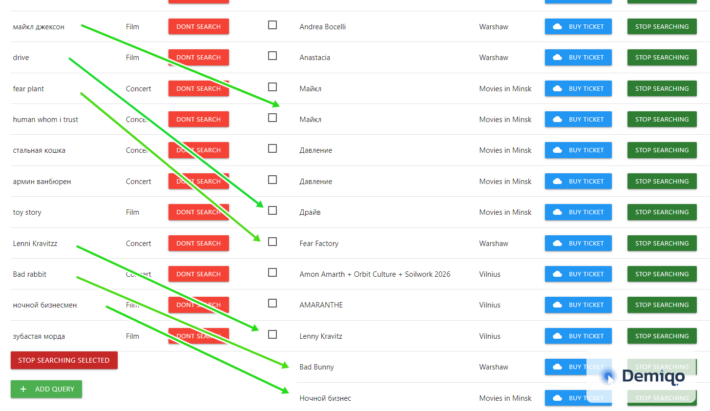
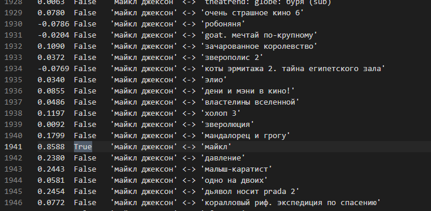
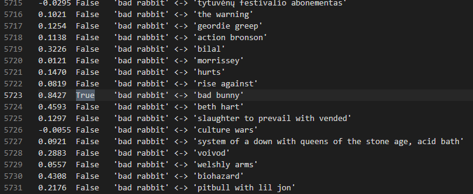
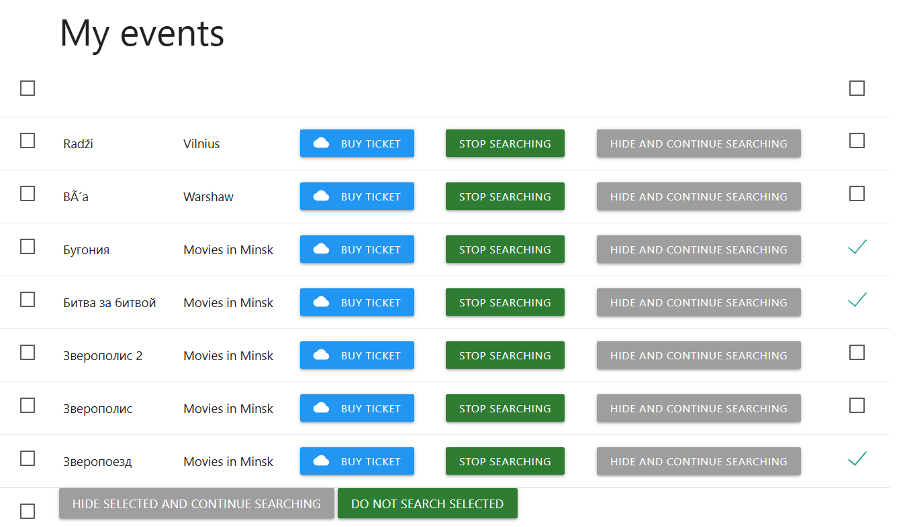
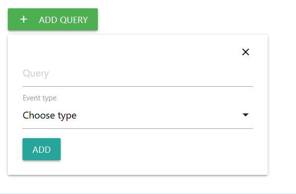
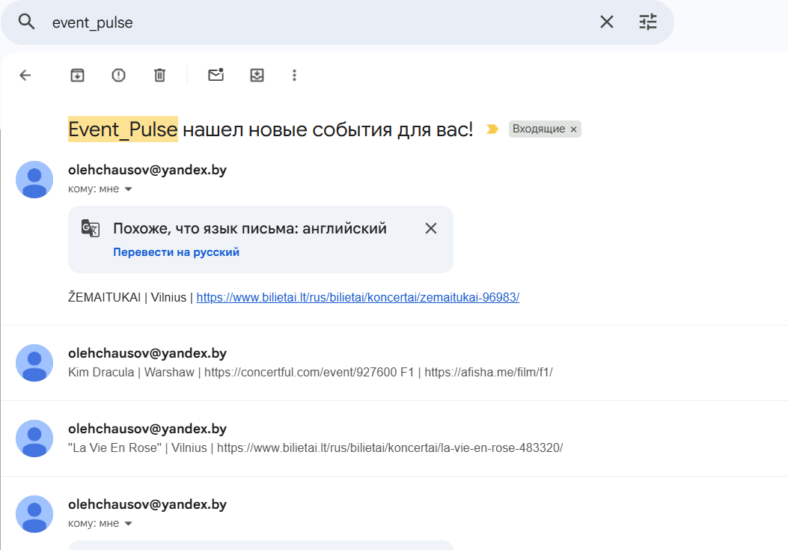
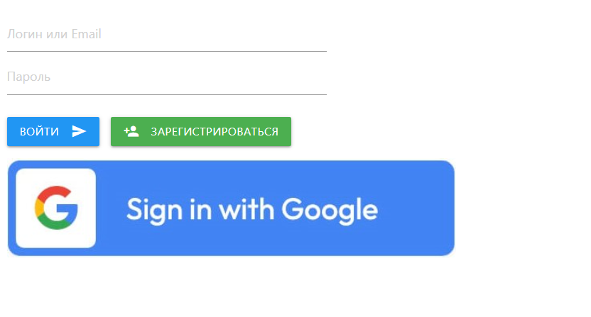
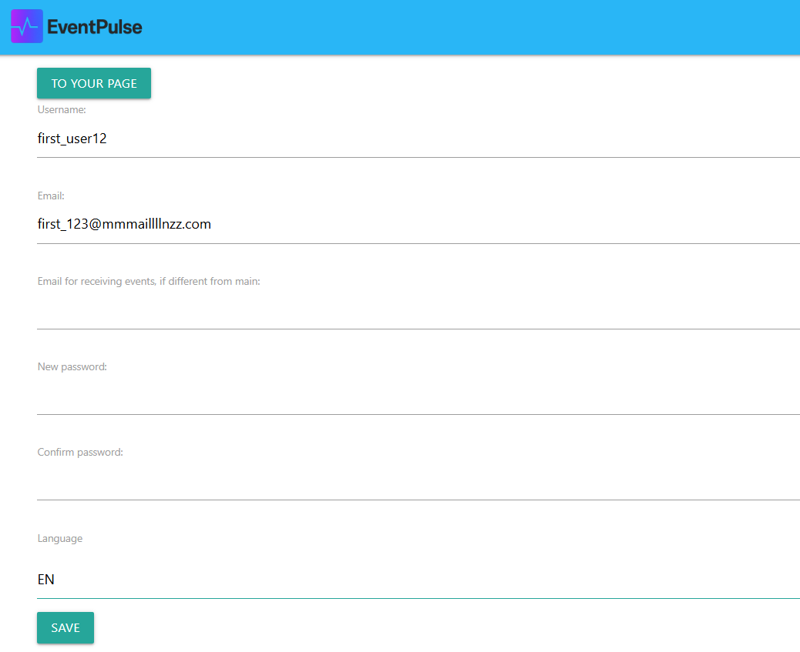

# EventPulse 3.0 — AI‑Powered Event Tracker

EventPulse 3.0 is an intelligent system for tracking upcoming events:

- Movies in Minsk  
- Concerts in Warsaw and Vilnius  

Users leave a **query** (e.g., “Dune”, “Metallica Warsaw”, “Rammstein”), and the system automatically monitors future events.  
When a matching event appears, EventPulse:

- Displays it in the user’s event list  
- Sends an email notification with a ticket link  
- Allows users to manage queries (pause, resume, delete)

---

## 🔥 What’s New in EventPulse 3.0

### **AI Semantic Matching (BAAI/bge‑m3)**  
EventPulse 3.0 introduces a fully AI‑driven matching system powered by the **BAAI/bge‑m3** model:

- Understands meaning, not just text similarity  
- Ignores typos (“metalica” → Metallica)  
- Handles multilingual queries (RU/EN/PL/LT)  
- Recognizes synonyms and context  
- Converts queries into embeddings and compares them with event embeddings  
- Fine‑tuned on a **10,000‑pair custom dataset**, achieving high precision for concerts and movies  

This makes matching **far more accurate** than fuzzy search or string comparison.

---

### 📦 Model Delivery via Hugging Face

EventPulse 3.0 uses the fine‑tuned **BAAI/bge‑m3** model hosted on Hugging Face.  
The model is automatically downloaded during deployment through a dedicated initialization script inside the Docker Compose environment.

This ensures:

- consistent model version across all deployments  
- no need to store large model files inside the repository  
- automatic setup on fresh servers  
- reproducible AI matching behavior  

The worker service loads the model on startup and keeps it in memory for fast semantic matching.

---

### **Dedicated Worker for Parsing & Matching**  
All heavy tasks are offloaded to a separate worker service:

- Parsing websites  
- Generating embeddings  
- AI matching  
- Caching repeated queries  
- Caching repeated event posters  

The main FastAPI application stays **fast, responsive, and stable**.

---

### **Smart Caching System**  
EventPulse 3.0 caches:

- Repeated user queries  
- Repeated event posters  
- Embeddings for identical strings  

This significantly reduces CPU load and speeds up matching.

---

### **Infrastructure Improvements**

- Docker Compose environment  
- Nginx reverse proxy  
- Adminer for database inspection  
- Production‑ready project structure  
- Clean separation of services  
- Faster debugging and deployment  

---

## 🔐 Authentication

- Secure password login (hashes only)  
- Google OAuth login  
- English and Russian language support  

---

## ⚙️ Tech Stack

- Python + FastAPI  
- BAAI/bge‑m3 (semantic embeddings)  
- PostgreSQL  
- Redis (caching + queues)  
- HTMX JS  
- OAuth0  
- SMTP Yandex  
- Materialize CSS  
- Docker + Nginx  

---

## 🔑 Features

- JWT‑based session middleware  
- Private, public, and semi‑public routes  
- Auto‑renewal of sessions  
- Browser language detection  
- Secure password hashing  
- Asynchronous architecture  
- AI‑powered semantic matching  
- Worker‑based parsing and matching  
- Caching of embeddings and repeated queries  

## ⚙️ Environment Variables (`.env`)

Create a `.env` file in the root directory and configure the following variables:

```
# Database
DB_USER=
DB_PASSWORD=
DB_HOST=
DB_PORT=
DB_NAME=

# Sessions (JWT)
SECRET_KEY=
ALGORITHM=
ACCESS_TOKEN_EXPIRE_MINUTES=
SLIDING_THRESHOLD_MINUTES=

# Email Notifications (SMTP)
SMTP_SERVER=
SMTP_PORT=
SMTP_LOGIN=
SMTP_PASSWORD=

# Google OAuth
OAUTH0_DOMAIN=
OAUTH0_CLIENT_ID=
OAUTH0_CLIENT_SECRET=
OAUTH0_REDIRECT_URI=

# AI & Matching similarity threshold. 0.7 if not defined here
FUZZY_THRESHOLD=
```

---

## 📸 Screenshots

  
  
  
  
  
  
  
  


---

## 📬 Feedback  
@Sharky1111

---

## 📖 License  
EventPulse is distributed under the MIT License.  
You may use, modify, and share the application freely, provided the copyright notice and license text remain included.

---

# 📘 README (Русский)

# EventPulse 3.0 — AI‑трекер событий

EventPulse 3.0 — интеллектуальная система для отслеживания будущих событий:

- Кино в Минске  
- Концерты в Варшаве и Вильнюсе  

Пользователь оставляет **запрос** (например, «Дюна», «Metallica Warsaw», «Rammstein»), а система автоматически ищет будущие события.  
Когда подходящее событие найдено, приложение:

- Показывает его в списке событий  
- Отправляет уведомление по email со ссылкой на билеты  
- Позволяет управлять запросами (остановить поиск, продолжить, удалить)

---

## 🔥 Что нового в EventPulse 3.0

### **AI‑семантическое сравнение (BAAI/bge‑m3)**  
В версии 3.0 появился полноценный AI‑мэтчинг на основе модели **BAAI/bge‑m3**:

- Понимает смысл, а не просто совпадение строк  
- Не обращает внимания на опечатки («metalica» → Metallica)  
- Работает с разными языками (RU/EN/PL/LT)  
- Понимает контекст и синонимы  
- Сравнивает эмбеддинги запросов и событий  
- Дообучена на **10 000 пар** специально под задачу концертов и фильмов  

Точность значительно выше, чем у fuzzy‑поиска.

---

### 📦 Загрузка модели через Hugging Face

EventPulse 3.0 использует дообученную модель **BAAI/bge‑m3**, размещённую на Hugging Face.  
Во время деплоя модель автоматически скачивается с помощью специального инициализационного скрипта внутри Docker Compose.

Это обеспечивает:

- одинаковую версию модели на всех серверах  
- отсутствие необходимости хранить большие файлы в репозитории  
- автоматическую установку на чистых окружениях  
- воспроизводимое поведение AI‑мэтчинга  

Воркер загружает модель при старте и держит её в памяти для быстрого семантического сравнения.

---

### **Отдельный воркер для парсинга и мэтчинга**

Все тяжёлые операции вынесены в отдельный сервис:

- Парсинг сайтов  
- Генерация эмбеддингов  
- AI‑мэтчинг  
- Кэширование повторяющихся запросов  
- Кэширование повторяющихся афиш  

Основной FastAPI‑сервер остаётся быстрым и стабильным.

---

### **Умное кэширование**

Система кэширует:

- Повторяющиеся запросы  
- Повторяющиеся афиши  
- Эмбеддинги одинаковых строк  

Это снижает нагрузку на CPU и ускоряет работу.

---

### **Улучшенная инфраструктура**

- Docker Compose  
- Nginx reverse proxy  
- Adminer для просмотра БД  
- Продакшен‑готовая структура  
- Чёткое разделение сервисов  
- Удобная отладка  

---

## 🔐 Авторизация

- Логин по паролю (хранится только хэш)  
- Вход через Google OAuth  
- Русский и английский языки  

---

## ⚙️ Стек технологий

- Python + FastAPI  
- BAAI/bge‑m3  
- PostgreSQL  
- Redis  
- HTMX  
- OAuth0  
- SMTP Yandex  
- Materialize CSS  
- Docker + Nginx  

---

## 🔑 Особенности

- JWT‑миддлвар  
- Приватные и публичные маршруты  
- Автопродление сессии  
- Определение языка браузера  
- Безопасное хранение паролей  
- Асинхронная архитектура  
- AI‑семантический мэтчинг  
- Вынесенный воркер  
- Кэширование эмбеддингов и запросов  

## ⚙️ Переменные окружения (`.env`)

Создайте файл `.env` в корневом каталоге проекта и заполните следующие параметры:

```env
# База данных
DB_USER=
DB_PASSWORD=
DB_HOST=
DB_PORT=
DB_NAME=

# Сессии (JWT)
SECRET_KEY=
ALGORITHM=
ACCESS_TOKEN_EXPIRE_MINUTES=
SLIDING_THRESHOLD_MINUTES=

# Уведомления по почте (SMTP)
SMTP_SERVER=
SMTP_PORT=
SMTP_LOGIN=
SMTP_PASSWORD=

# Google OAuth
OAUTH0_DOMAIN=
OAUTH0_CLIENT_ID=
OAUTH0_CLIENT_SECRET=
OAUTH0_REDIRECT_URI=

# Порог смысловой схожести для ИИ и мэтчинга (по умолчанию 0.7, если не задано)
FUZZY_THRESHOLD=
```

---

## 📸 Скриншоты

(см. выше)

---

## 📬 Обратная связь  
@Sharky1111

---

## 📖 Лицензия  
EventPulse распространяется под MIT License.  
Разрешено свободное использование, изменение и распространение при сохранении текста лицензии.
